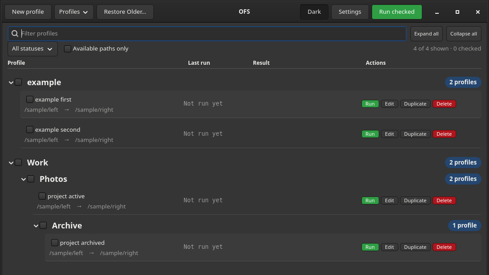
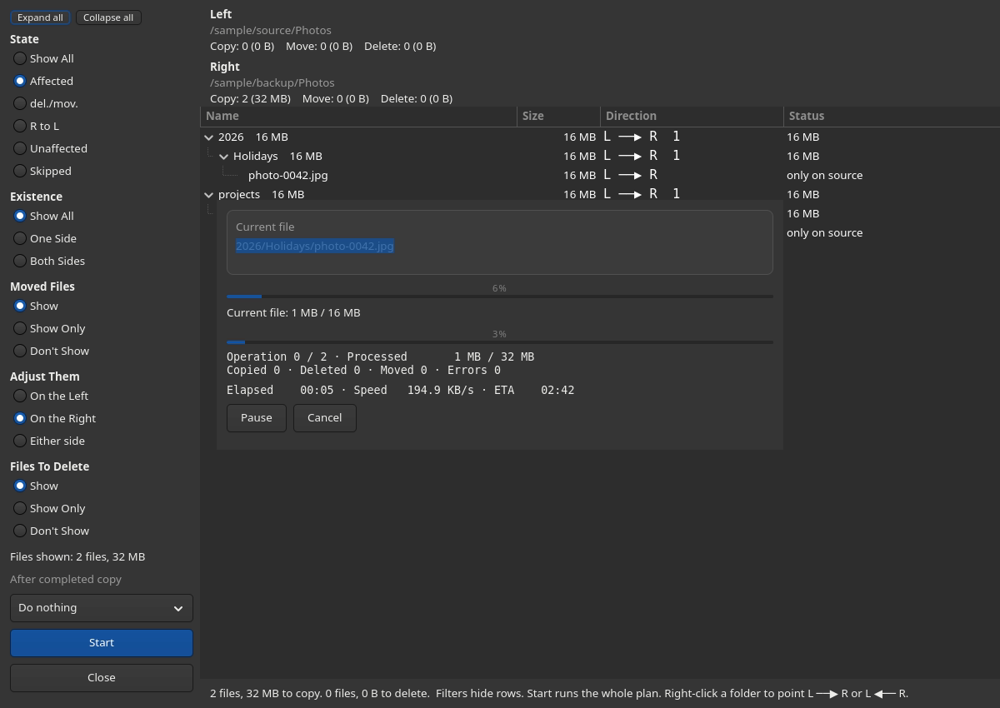
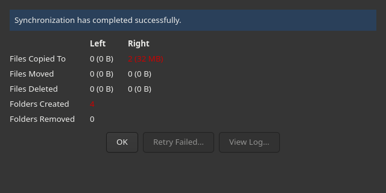

# OFS

**A GTK 4 folder-synchronization app for Linux, built for organized profiles, clear previews, and safe copying.**

Use local folders or OS-mounted NAS, SMB/CIFS, NFS, SSHFS, and rclone storage.

[Features](#features) · [Install](#install) · [Documentation](#documentation) · [Source and testing](#source-and-testing)

## Features

| | What OFS gives you |
|---|---|
| 🗂️ **Organized profiles** | Custom groups and subgroups, group selection, search and filters, Multi Edit, profile export/import, and safe path replacement after a mount or folder move. |
| 🔍 **Understandable scans** | Live discovery counts, elapsed time, repeat-scan ETA estimates and resumable scanning, followed by a clear file/folder preview. |
| 🛡️ **Safe synchronization** | Copy-only or Exact Mirror, timestamp and optional binary comparison, reviewed deletions, configurable deletion limits, and atomic temporary-file replacement. |
| 🗃️ **Recovery when needed** | Optional recovery of deleted files, retained replaced versions, and restoration into a separate destination without overwriting existing files. |
| 🔗 **Links and metadata** | Follow, preserve, or skip symlinks; optional permission/owner comparison and safe owner/group preservation. |
| ⚡ **Responsive progress** | Total and per-file bars, speed/ETA, pause/resume, cancellation, optional throttling, logs, results, and retry through a fresh scan. |
| 🌗 **A comfortable interface** | System, Light, or Dark appearance, a quick header Dark toggle, themed row separators, and readable status colors. |
| 💾 **Practical controls** | Profile disabling, checked-profile renaming, and a stable scan path with middle truncation, full-path tooltip, and copyable text. |

**[Read the complete feature reference →](docs/features.md)**

## Install

> **Version note:** the currently published `v0.2.0` downloads predate many features above. [Run the current source](#source-and-testing) for those additions.

OFS needs **Python 3.11+ and GTK 4 on the machine**; neither is bundled.

### AppImage

**[Download OFS-0.2.0 for x86_64](https://github.com/jitrc/open-flexible-sync/releases/download/v0.2.0/OFS-0.2.0-x86_64.AppImage)**

```bash
chmod +x OFS-0.2.0-x86_64.AppImage
./OFS-0.2.0-x86_64.AppImage
```

If GTK support is missing on Debian/Ubuntu:

```bash
sudo apt install python3-gi python3-gi-cairo gir1.2-gtk-4.0
```

On Fedora:

```bash
sudo dnf install python3-gobject gtk4
```

### Tar archive

For machines without AppImage, download `OFS-0.2.0-linux-x86_64.tar.gz` from [GitHub Releases](https://github.com/jitrc/open-flexible-sync/releases):

```bash
tar -xzf OFS-0.2.0-linux-x86_64.tar.gz
./OFS-0.2.0/ofs
```

## Overview







*Synthetic profile names and placeholder paths. Copy progress is captured from a small temporary test copy; the results report reflects its actual successful totals. No live data or power actions are used.*

## Documentation

- **[Complete feature reference](docs/features.md):** profiles, scanning, copying, recovery, metadata, and progress.
- **[User guide](docs/usage.md):** profiles, previews, safety confirmation, settings, and CLI behavior.
- **[Project specification](docs/spec.md):** implemented requirements, compatibility decisions, and future scope.

## Source and testing

From a checkout:

```bash
./launch.sh
./launch.sh list
./launch.sh import                         # import settings without changing the 5.71 cfg
```

Scan and run:

```bash
./launch.sh scan "Profile name"             # scan and print a plan
./launch.sh run "Profile name"              # dry-run
./launch.sh run "Profile name" --apply      # apply with configured safeguards
```

Test or build:

```bash
python3 -m pytest -q
xvfb-run -a python3 -m pytest -q            # headless machine
python3 scripts/build_release.py
```

A matching `v*` tag runs tests and publishes artifacts through CI.

## Configuration

Profiles and preferences are stored under `~/.config/open-flexible-sync`. Use `OFS_HOME` to select another configuration directory.

The original 5.71 configuration is imported without changing that file. See the [feature reference](docs/features.md) for grouping, migration, and mounted-volume behavior.

## Current limitations

No scheduled background execution, real-time watching, parallel copying, partial-file updates, ZIP packages, email notifications, or native FTP/S3/Google Drive/Dropbox backends. OS-mounted folders remain supported as ordinary filesystem paths.
